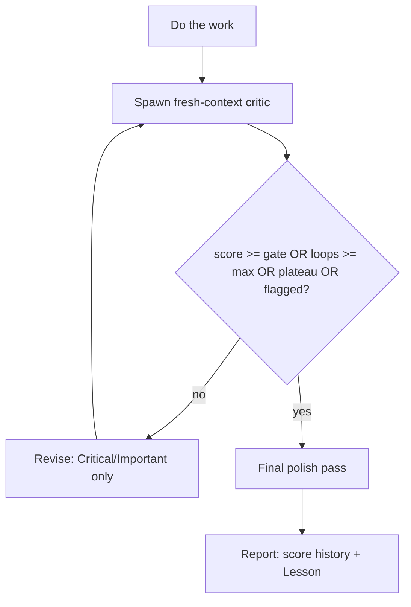

# Review Loop

Worker-critic review cycle: you do the work, a separate fresh-context critic subagent scores it, you revise, repeat until gate or budget.

**Core principle:** first drafts are never final; critique with evidence beats a single confident pass.

## Modes

| Mode | Who starts it | Example |
|---|---|---|
| A — do and review | user, at task start | "implement X, use review-loop, gate 8" |
| B — review existing | user, on finished work | "run review-loop on the auth module" |
| C — agent proposal | you, when finished work touches risky paths (auth, data layer, config, >3 files) or verification failed twice | finish → "review-loop this before commit?" — wait for the user's yes; never auto-run |

## Triggers

- Mode A/B: any of "use review-loop", "/review-loop", "polish this", "iterate on this", "rivedi con ciclo critico", "fai fare la review", "miglioralo con feedback", "revisione con feedback".
- Mode C: risky-path finish — propose once per deliverable, in one line.
- Not for: trivial fixes (tests + CI are the gate), exploratory spikes, tasks with no acceptance criteria (define those first).

## Defaults

| Setting | Default | Overrides |
|---|---|---|
| min loops | 1 | "min N loops" |
| max loops | 4 | "max N loops"; "quick"/"fast" → max 2 |
| quality gate | 8 | "gate N"; "thorough"/"stricto" → 9; "quick" → 6 |

Cost tier: the critic starts on a **cheap/balanced model** — it reads a diff, it does not design. Escalate the critic's model only when the score stalls (see Plateau). The worker must be smart enough to act on the feedback.

## Critic contract (what makes the score mean something)

The critic subagent:

- is a **fresh context**: receives work product, criteria, and the verification command — never your reasoning or conversation;
- **runs the verification command** when the brief has one, and quotes its real output;
- attaches `file:line` to every issue, classifies Critical / Important / Minor, and ends with "Score: N/10";
- **evidence rule:** fewer than 2 concrete defects → maximum score 6. Vague praise-or-doom caps the loop.

```
You are a critical reviewer. Score 1-10 with specific, actionable feedback.
Task: {one line}
Criteria (what matters for THIS task): {3-6 measurable bullets}
Ground rules: read the work; run the verification command if listed and
quote its output; every issue gets file:line + why it matters + the fix;
no politeness. Scoring: 1-3 broken/missing requirements · 4-6 significant
issues · 7-8 minor · 9-10 ready. Fewer than 2 concrete defects → max 6.
Work: {file paths + relevant excerpts}
```

Criteria by task type: code → correctness, edge cases, error handling, security · spec → completeness, no hand-waving, measurable success · refactor → zero behavior change · bug fix → root cause addressed + regression test · IaC → idempotency, least privilege, destroy safety · migration → reversibility, data-loss risk.

## Process



Stop conditions, in order: (1) score ≥ gate → stop; (2) loops ≥ max → stop; (3) **plateau** — two consecutive iterations with Δscore < 1 and the same recurring issues → stop and report unresolved issues honestly; (4) deliverable went `flagged` (lane cap hit) → abort the loop; (5) min 1: at least one critique always runs.

Revising: fix Critical and Important only — never rewrite the whole deliverable when the feedback names two lines. Keep a ledger of all prior feedback so fixed issues stay fixed. If the critic is wrong, push back with code/tests and note it in the report; never lower the gate to compensate.

## Report

```
--- Review Loop: {task} ---
Loop 1/4: 6/10 — {top issues}
Loop 2/4: 8/10 — {minor}
Result: gate met · stopped at plateau (unresolved: …) · max loops.

### Lesson (≤3 lines)
- {what this deliverable or its critique revealed — for the next session}
```

## Red flags

Never: self-review instead of spawning a critic · feed the critic your reasoning · inflate scores · continue past max loops without user consent.

Escalate (user decides): stronger worker or critic model, split into smaller review-loops, or ship with the gap noted.
