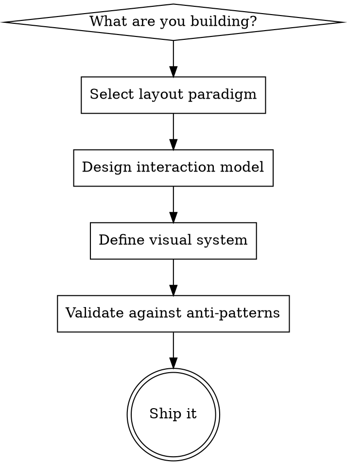

# Motion & Rendering — Deep Reference

Companion to SKILL.md §6 (Animation).

## Flicker-Free Rendering Stack

Three layers, all required for smooth TUI rendering:

1. **Double buffering** — render to an off-screen buffer, diff against the previous frame, emit only changed cells.
2. **Synchronized output** — wrap the frame in `CSI ? 2026 h` … `CSI ? 2026 l` for atomic terminal render.
3. **Batched writes** — combine all escape sequences into a single `write()` syscall.

## When to Animate

| Situation         | Animation               | Duration            |
| ----------------- | ----------------------- | ------------------- |
| View transition   | Fade or slide           | 100-200ms           |
| Selection change  | Instant highlight       | 0ms (never animate) |
| Data loading      | Spinner or skeleton     | Until complete      |
| Success feedback  | Brief flash/checkmark   | 1-2 seconds         |
| Panel resize      | Immediate reflow        | 0ms                 |
| Chart data update | Smooth value transition | 200-500ms           |

Binding rule from SKILL.md: animations never delay user input — a keypress cancels the transition and responds immediately.

## Spinner Selection

| Context          | Spinner                   | Interval |
| ---------------- | ------------------------- | -------- |
| Default / modern | Braille dots `⠋⠙⠹⠸⠼⠴⠦⠧⠇⠏` | 80ms     |
| Minimal          | Line `-\|/`               | 130ms    |
| Heavy processing | Blocks `▖▘▝▗`             | 100ms    |
| Fun / branded    | Custom frames             | 70-100ms |

Use spinners for indeterminate operations and progress bars for determinate ones. Show a spinner only after a 200ms delay so fast operations don't flash.

## Real-Time Updates

- Cap refresh to 15-30 FPS for dashboards (saves CPU, prevents flicker).
- Differential updates — redraw only changed cells.
- Stream text (AI responses, logs) at a readable pace, not network burst speed.
- Background operations report in a status-bar widget; never block the main loop.

## Design Process Flowchart

